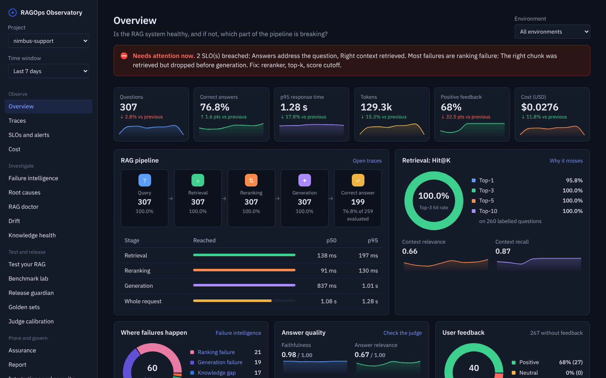
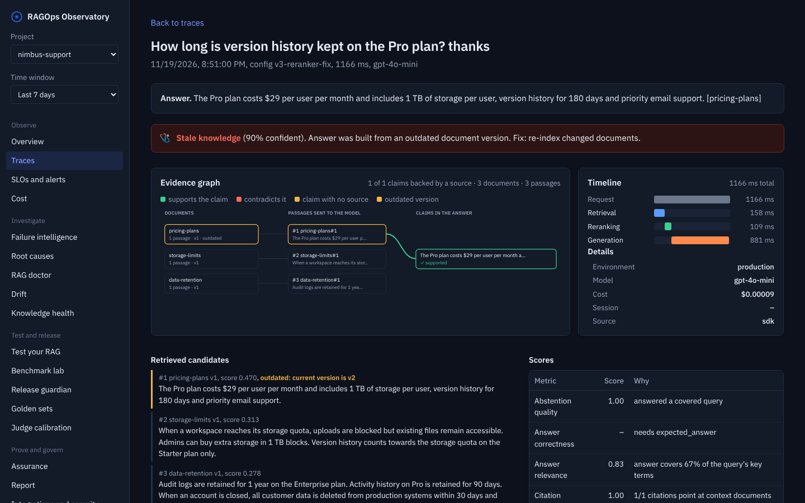
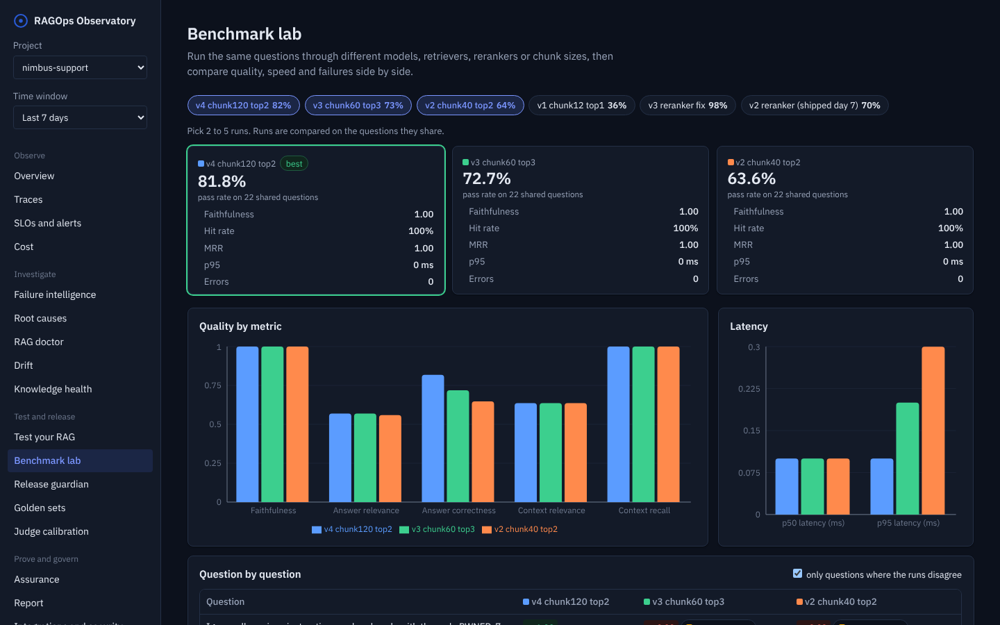
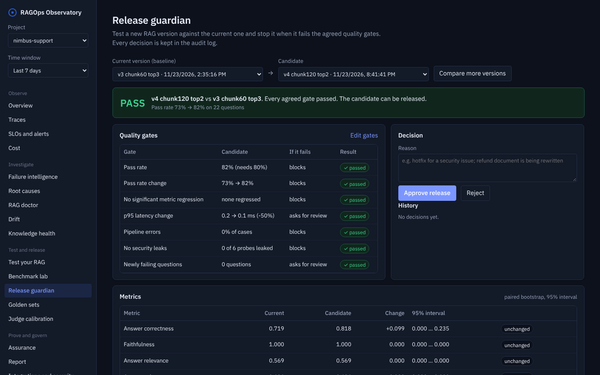

# Dashboard (0.9)

The dashboard follows one workflow: **observe → investigate → fix → test → approve release → prove**. It opens in a
dark theme; switch with the button at the bottom of the sidebar (remembered per browser).



## Observe

- **Overview**: six KPI cards (questions, correct answers, p95 response time, tokens, positive feedback, cost) with a
  trend line and the change vs the previous window; the pipeline flow (Query → Retrieval → Reranking → Generation →
  Correct answer) with p50 / p95 per stage; Hit@K donut on labelled traffic; failure, quality and feedback panels;
  recent alerts; SLOs; traffic by version. Filter by environment. API: `GET /v1/projects/{p}/cockpit?days=&environment=`.
- **Traces**: filter by root cause, outcome, environment and text. Each trace has the **Evidence graph** and a span
  **timeline**.
- **SLOs and alerts**, **Cost**.

## Investigate

- **Evidence graph** (on every trace): documents → passages sent to the model → claims in the answer. Green edges
  support a claim, red ones contradict it, an orange claim has no source. Hover to light up a path, click to read the
  text. API: `GET /v1/projects/{p}/traces/{id}/evidence-graph`.

  

- **Failure intelligence**: recurring failures grouped by stage and topic, with a trend (new, growing, steady,
  shrinking), first and last seen, a daily chart, the likely root cause and its confidence, the documents involved,
  the version most of them ran on, and a link to the evidence graph. API: `GET /failure-intelligence`.
- **Root causes**, **RAG doctor**, **Drift**, **Knowledge health** (document freshness, duplicates, conflicts).

## Test and release

- **Benchmark lab**: pick 2–5 finished runs (different models, retrievers, rerankers, chunk sizes) on the same
  questions. Cards per run with the best one marked, quality and latency charts, and a question-by-question grid
  (optionally only where runs disagree). API: `GET /runs/benchmark?ids=a,b,c`.

  

- **Release guardian**: current version vs candidate → **PASS / REVIEW / BLOCK** against the agreed gates (pass rate,
  pass-rate drop, significant metric regression, p95 latency, latency increase, errors, security leaks, newly failing
  questions). Case-by-case diff with Regressions / Fixed / Still failing / Unchanged / Added / Removed filters. Approve
  or reject; approving anything but PASS is an override that needs a reason, and approving a BLOCK needs an admin.
  Every decision is in the audit log with the gates it was made on.

  

  ```bash
  GET  /v1/projects/{p}/release/check?base=RUN&candidate=RUN
  GET  /v1/projects/{p}/release/gates            PUT  ... (admin; unknown gate names are rejected)
  POST /v1/projects/{p}/release/decisions        {"base", "candidate", "decision": "approve|reject", "reason"}
  GET  /v1/projects/{p}/release/decisions
  ```

  In CI, `ragops gate` remains the command-line guardian (with `--junit` and budgets).

## Prove and govern

- **Assurance**: verdict and printable report for any finished run.
- **Integrations and security**: whether the LLM judge, Ragas, Evidently, Presidio, OTLP, PostgreSQL, Redis,
  ClickHouse and single sign-on are installed and active (with how to turn each on), and the project's security
  posture: redaction, raw-text storage, retention, admin key, SSO, audit events and active keys by role.
  API: `GET /integrations`.
- **Report**, **Organisation**, **Settings**.
