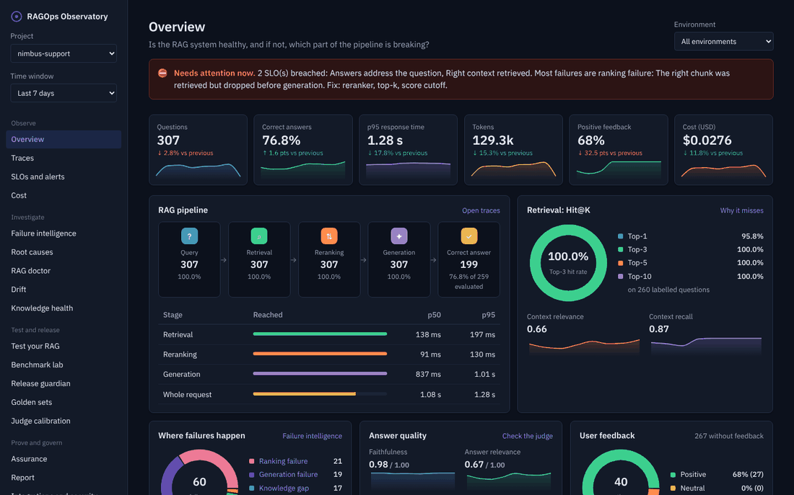

# RAGOps Observatory

**Prove your RAG works.** Find which stage of your RAG pipeline fails and why, block worse releases before they ship,
and hand clients a sealed **Ready / Not ready** report. Self-hosted, open source, MIT-licensed.



```bash
pip install "ragops-observatory[server,dashboard]"
ragops demo && ragops serve        # open http://localhost:8000/ui · key: ragops-admin-dev-key
```

<div class="grid cards" markdown>

- **Test your own RAG** in three commands: generate questions from your documents, run them, get a verdict.
  [Test your RAG](test-your-rag.md)
- **See why answers fail**: every failure gets a pipeline stage, evidence and a fix; the evidence graph shows which
  source supports each claim. [Dashboard tour](dashboard.md)
- **Release safely**: the release guardian compares a candidate with production and says Pass, Review or Block.
  [Release gate](gate.md)
- **Prove it**: a fingerprinted assurance report mapped to RBI FREE-AI, the EU AI Act and ISO/IEC 42001.
  [Assurance](assurance.md)

</div>

## Results

- [Case study: Not ready → Ready](case-studies/my-rag.md): a real assistant, four problems found, verdict proven.
- [Field report](field-report.md): the same RAG in LlamaIndex, LangChain, LangGraph and Haystack.
- [Benchmarks](benchmarks.md): 89.6% correct stage on 365 injected failures; 73.8% on SQuAD 2.0.

## Where next

- New here? [Quickstart](quickstart.md).
- Already using Langfuse, Phoenix, LangChain or LlamaIndex? [Integrations](integrations.md).
- Running it for a team? [Deployment and security](deployment.md).
